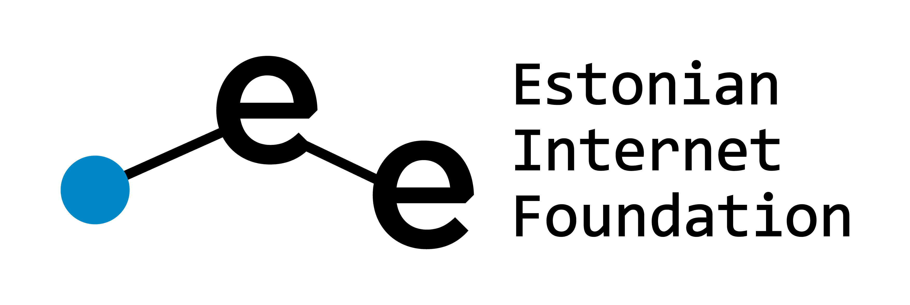
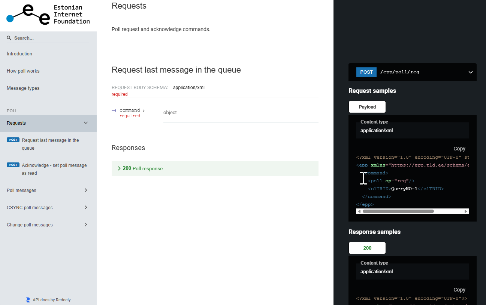

<p align="center">
  
</p>

# EPP Poll API Documentation

<p align="center">
  
</p>

Documentation of EPP poll messages issued by the .ee registry. The goal is to help registrars build automation that processes poll notifications.

## Documentation

**https://internetee.github.io/poll-apidoc/**

## Repository contents

| File | Description |
|---|---|
| `index.html` | Redoc documentation page |
| `openapi.yaml` | Poll message and request definitions with XML examples |
| `eif-logo.png` | Logo displayed in the documentation sidebar |

## Local preview

```bash
python3 -m http.server 8081
```

Then open `http://localhost:8081` in your browser.
